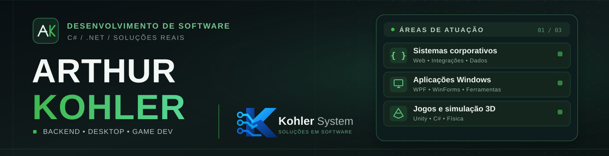
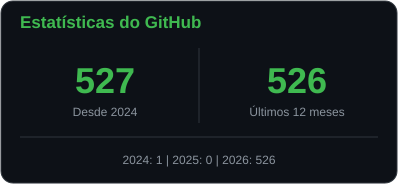
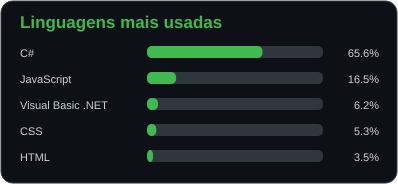

**Arthur Kohler** · Desenvolvedor C#/.NET · Criador da **Kohler System**.

Sou estudante de **Sistemas de Informação** e profissional de TI no setor industrial. Desenvolvo **sistemas comerciais, aplicações desktop e soluções web** para problemas reais de negócio.

Por meio da **Kohler System**, apresento produtos como o [VENDRA](https://github.com/ArthurKohlerDev/vendra-showcase) e soluções que priorizam organização, confiabilidade e facilidade de uso.

---

## Sobre mim

Atuo na área de **Tecnologia da Informação da MH Tinturaria**, onde adquiro experiência com processos industriais, sistemas corporativos, integração de dados e automação.

Além da atuação profissional, desenvolvo soluções próprias por meio da **Kohler System**, com foco em sistemas de gestão comercial, aplicações desktop e ferramentas que simplificam processos.

Minha principal especialidade é o ecossistema **C# e .NET**, trabalhando com desenvolvimento web e desktop, bancos de dados, arquitetura de software e testes automatizados.

Busco desenvolver soluções que combinem **funcionalidade, confiabilidade e facilidade de uso**.

## Eventos

Participando do **[Hack Brasil 2026](https://hackbrasil.com/)** na trilha de **Saúde e Bem-Estar**, desenvolvendo em equipe uma solução tecnológica para desafios reais.

## Projetos em destaque

### [VENDRA — Sistema de Gestão Comercial](https://github.com/ArthurKohlerDev/vendra-showcase)

**Produto desenvolvido pela Kohler System**

Sistema desktop para Windows, desenvolvido para pequenos comércios,
com foco em simplificar a gestão e as operações do dia a dia.

- Controle de estoque e movimentações.
- Vendas, caixa e emissão de comprovantes.
- Gerenciamento de rifas, reservas e pagamentos.
- Sorteios, premiações e controle de retiradas.
- Integração opcional com grupos do WhatsApp.

**Tecnologias:** C#, .NET 8, WPF e Firebird 3.0.

**Status:** Em preparação para implantação comercial.

[Conhecer o VENDRA e visualizar suas telas](https://github.com/ArthurKohlerDev/vendra-showcase)

  

---

### [Nexo Gestão](https://github.com/ArthurKohlerDev/Sistema-ERP)

Projeto fictício de portfólio para gestão comercial, com caixa/PDV, estoque e rifas. Desenvolvido em **ASP.NET Core (.NET 8)**, **Entity Framework Core**, **MySQL** e **HTML/CSS/JavaScript**. O repositório documenta as funcionalidades, a arquitetura e a execução local.

---

### [Semáforo Inteligente](https://github.com/ArthurKohlerDev/semaforo)

Simulador web de dois semáforos sincronizados, com **gêmeo digital** e comunicação **MQTT via WebSocket**. O projeto reúne interface em HTML/CSS/JavaScript e lógica de controle do cruzamento.

Além dos projetos públicos, trabalho com aplicações desktop em **C# e WPF** e com soluções para processos industriais.

## Tecnologias

**Backend e desktop**

**Web e integração**

**Dados**

**Ferramentas**

---

## Atividade no GitHub

  
  

  

---

**Software para resolver problemas reais.**

